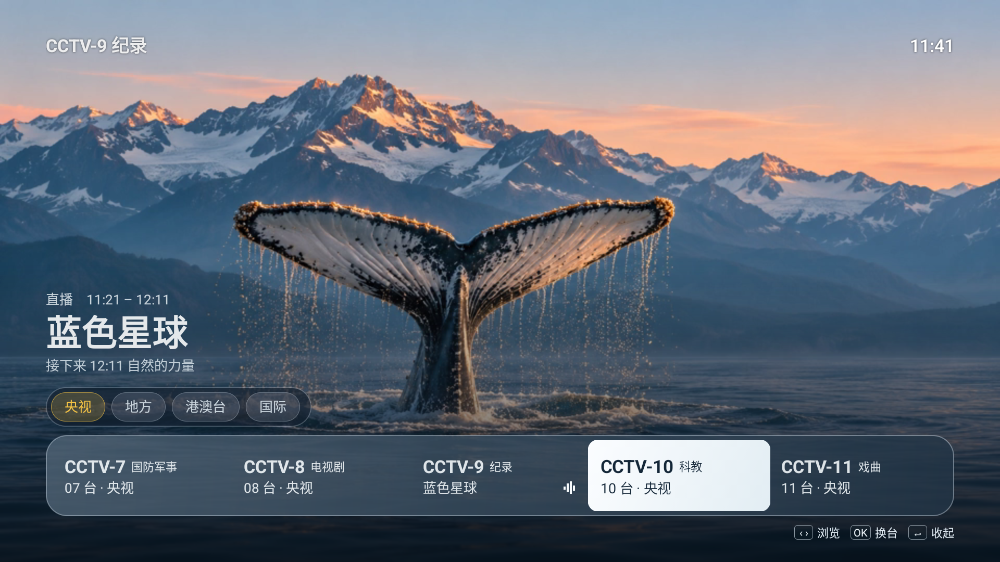

# XiaoP-TV · 小屁TV

面向 Android 电视和投影的直播应用，基于 [lizongying/my-tv](https://github.com/lizongying/my-tv) 改造。

[下载安装包](https://github.com/ZhengYitong2333/XiaoP-TV/releases) · [上游项目](https://github.com/lizongying/my-tv)

## 功能

- 遥控器浏览频道、分组跳转、数字定位，确认后切台。
- 67 个内置频道，其中 64 个频道提供共 134 条备用线路。
- 按设备、频道记住上次成功出画的备用地址，下次优先播放，失败后自动切换。
- 支持选择源内可用的分辨率，显示当前备用线路序号。
- 半透明侧边设置面板、时间显示和网格频道列表。
- 从旧版 51 台目录迁移频道位置，之后按频道 PID 保存。

频道源会随时间和网络环境变化，画质与开播速度取决于实际线路。标称 4K、8K 的频道也可能使用 1080p 转播源。

## 界面




截图使用本地测试素材，展示频道浏览与设置界面。

## 安装

在 Releases 下载 XiaoP-TV.apk，通过 U 盘、设备安装工具或 ADB 安装。

```sh
adb install -r XiaoP-TV.apk
```

当前发布包为个人预览构建，应用名为“小屁TV”，包名为 com.lizongying.mytv.preview。
可覆盖本项目此前同签名的预览版本，保留设置和频道记录。此包使用调试签名。
内置检查更新目前仅显示上游版本信息，后续版本请从本仓库 Releases 下载。

已在 TCL 65V8M Pro 与极米 Z7X 安装并验证启动。部分 TCL 固件需要通过“多屏互动”安装。

## 构建与验证

使用 JDK 17、Android SDK 34 和本仓库 Gradle Wrapper。

```sh
./gradlew :app:assembleDebug -PIS_SO_BUILD=false
./gradlew :app:testDebugUnitTest
./gradlew :app:connectedDebugAndroidTest
```

调试包输出在 app/build/outputs/apk/debug/app-debug.apk。
项目随附原生库预编译文件。设备测试使用本地测试视频与 HTTP HLS 服务，覆盖遥控器焦点、选台、分辨率、线路重试、线路记忆和频道迁移。
本轮验证通过 JVM 测试 8 项、Android TV 模拟器测试 15 项。

## 上游与版权

本仓库保留原项目提交历史。原有代码、素材及版权归原作者所有，新增改动见提交记录。

以下保留上游版权说明。

本项目仅供学习研究，禁止用于商业用途，请于下载二十四小时内删除。

本项目可能随时终止，请大家谨慎使用，建议使用官方渠道进行观看。

本项目使用的部分代码、图片、文字等资源来源于网络，如有侵权，请联系删除。
